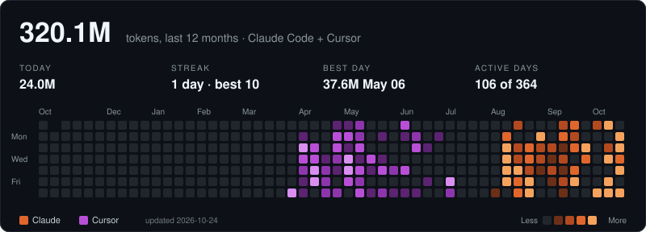

### Hi, I'm Furkan 👋

AI systems engineer in Ankara. I build agents that perceive, decide and act — mostly where LLMs meet blockchains and robots.

- AI Systems Intern at **HAVELSAN** — LoRA/QLoRA, RAG, guardrails, MCP, vLLM
- **Stellar Türkiye Ambassador** — building and mentoring on Soroban
- Previously: TÜBİTAK UZAY (satellite-imagery CV), FEV Global (embedded / ADAS), Bilim Konya (autonomous systems)

[LinkedIn](https://linkedin.com/in/furkanyesildag) · [X](https://x.com/furkanyesildag) · [Email](mailto:furkanyesildag08@gmail.com)

#### Selected work

| | |
|---|---|
| [**Cogladius**](https://github.com/furkanyesildag/cogladius) | AI-agent task marketplace on Stellar — Soroban escrow, paid only on an on-chain-verified judge verdict. 2× Stellar Instaward |
| [**Sentinel**](https://github.com/furkanyesildag/sentinel) | Non-custodial liquidation guard for Blend Protocol on Soroban |
| **KANIT** | Trading agent on OKX TR that seals every prediction on Avalanche before the outcome. 2nd place, OKX TR Agentic Hackathon 2026 |
| **WICK** | Autonomous AI market maker on Uniswap v4 hooks + Pyth, ported to Circle Arc |
| [**unasked**](https://github.com/furkanyesildag/unasked) · [**deadrules**](https://github.com/furkanyesildag/deadrules) | Tools for coding agents: catch out-of-scope edits; measure which CLAUDE.md rules actually matter |
| [**LLM UAV pilot assistant**](https://github.com/furkanyesildag/llm-uav-pilot-assistant) | Local LLM that turns natural-language commands into safety-checked UAV functions |

**Stack:** Python · TypeScript · Rust · Solidity · C++ — PyTorch, vLLM, Qdrant, MCP — Soroban, EVM — ROS2, Jetson

#### AI coding activity

